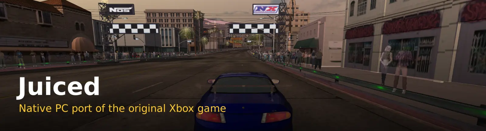
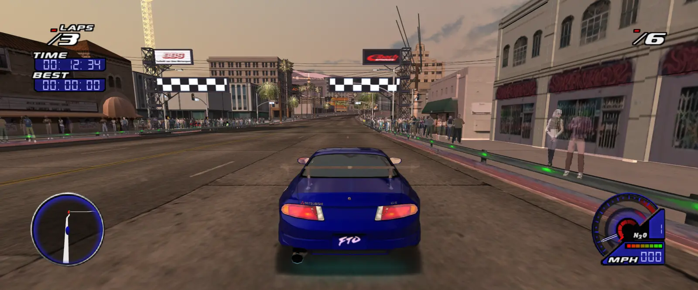
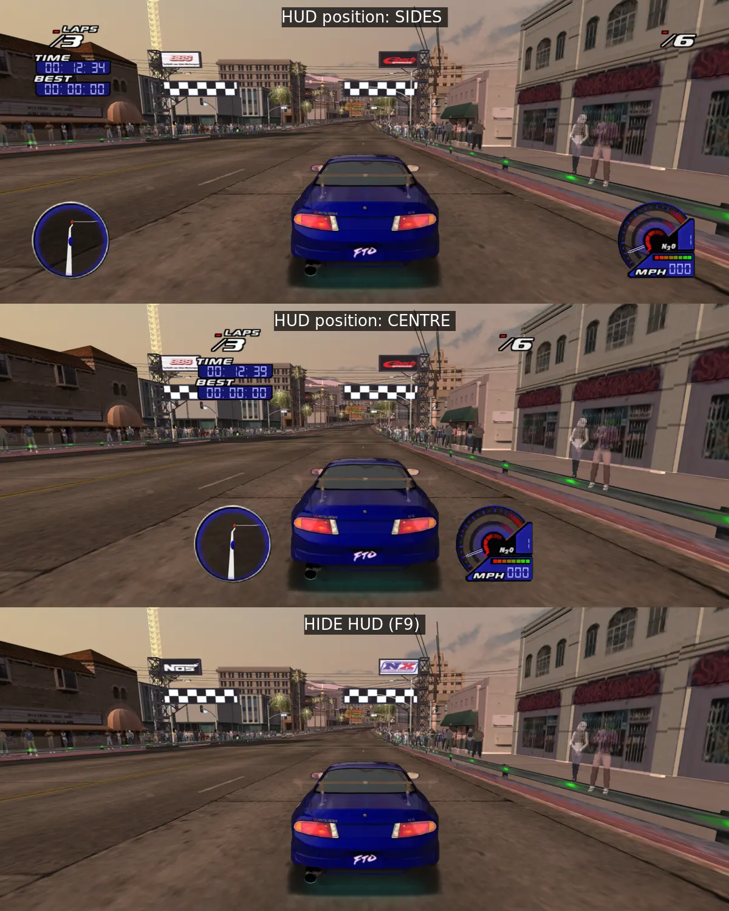
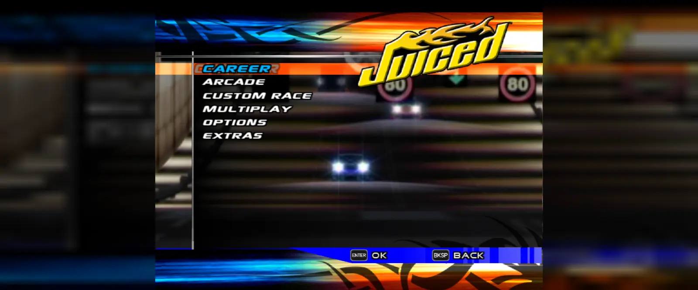
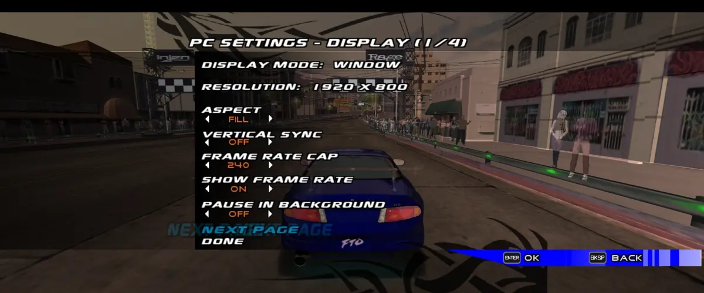
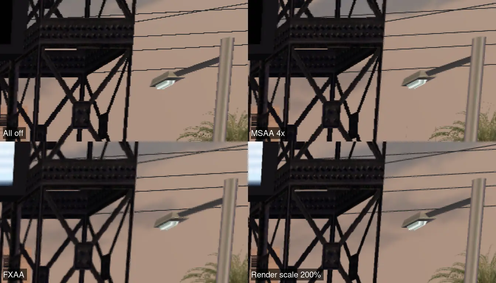
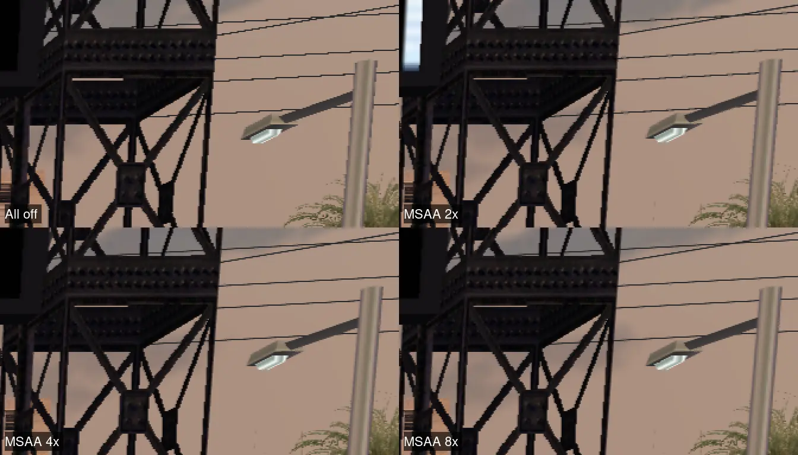
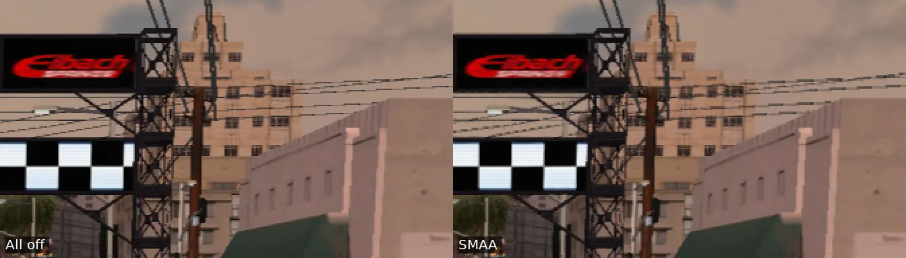

  

  
  
  

  <a href="#getting-started"><b>Getting started</b></a> &nbsp;·&nbsp;
  <a href="#building"><b>Building</b></a> &nbsp;·&nbsp;
  <a href="https://discord.gg/PQjkKsdtc"><b>Discord</b></a>

  

**The 2005 Xbox street racer, running natively on PC.** This is not an emulator. The game's own x86 code is
statically recompiled with the [Xbox XBE Recomp](https://github.com/TGP482/XboxXBE-Recomp) toolkit into a Windows
program, with a new renderer, sound and input underneath: true widescreen up to 21:9 and beyond, frame rates above
60, sharper graphics, mouse and keyboard, modern pads and wheels, and settings inside the game's own menus.

> [!NOTE]
> This project does not include any game assets. You need your own copy of the Xbox game to build and play.

## Table of contents

- [Xbox vs. PC](#xbox-vs-pc)
- [Features](#features)
- [Widescreen and the HUD](#widescreen-and-the-hud)
- [PC Settings](#pc-settings)
- [Graphics settings](#graphics-settings)
- [Controls](#controls)
- [Achievements](#achievements)
- [Requirements](#requirements)
- [Getting started](#getting-started)
- [FAQ](#faq)
- [Known issues](#known-issues)
- [Roadmap](#roadmap)
- [Community and support](#community-and-support)
- [Building](#building)
- [Credits and legal](#credits-and-legal)

## Xbox vs. PC
[(Back to top)](#table-of-contents)

  
   
  <i>All extras off vs. render scale 200%, MSAA 4x and sharpening 50%, at 1920x800.</i>

The Xbox drew Juiced at 640x480, at 4:3 or squeezed for a 16:9 TV, and at up to 60 frames a second. The port draws
it at your screen's resolution and shape, as often as your screen refreshes, with anti-aliasing and sharpening
layered on top of the game's own picture.

## Features
[(Back to top)](#table-of-contents)

| | |
|---|---|
| **Widescreen** | True proportions on any screen, 21:9 and wider included. Races fill the screen with the 3D view widened; the menus, title and movies keep their 4:3 shape in the middle with a dimmed, blurred copy filling the sides. |
| **Aspect, changed as you play** | Auto, 4:3, 16:9 or Fill, applied at once, in a race too. At 4:3 the race camera is the console's own. |
| **HUD position** | On a wide screen the dials, map and position sit at the screen's sides, or in the 4:3 centre nearer the car. **F9** hides the HUD altogether. |
| **High frame rates** | The game still runs its 60 steps a second, as its driving needs. Above a frame rate cap of 60, races draw the frames in between, made from the two steps before. |
| **Sharper graphics** | Render scale up to 200%, MSAA up to 8x, FXAA or SMAA, sharpening, anisotropic filtering, enhanced textures and sharp text and HUD. |
| **PC Settings in the game** | Options > PC SETTINGS on the title menus and the pause menu, in the game's own style. Everything is also in the F1 window and `settings.toml`. |
| **Mouse in the menus** | Point at an item and click to choose it; right click goes back. The pointer is drawn in the menus' own colours. |
| **Controllers and wheels** | Xbox, PlayStation and Switch pads with hot plugging and rumble; steering wheels with force feedback. Modern button pictures show today's Xbox pad, or your keys. |
| **Achievements** | A first set for race results, kept in `achievements.toml` beside the game. |
| **Quality of life** | Skip intro, an engines and effects level against the music, field of view, speed blur on or off, F12 screenshots at full resolution, Alt+Enter for full screen. |

## Widescreen and the HUD
[(Back to top)](#table-of-contents)

  
   
  <i>HUD POSITION: SIDES, then CENTRE, then the HUD hidden with F9. 1920x800 (21:9).</i>

In a race the 3D view is widened to your screen's shape. The HUD is drawn in the game's 4:3 layout; with **HUD
POSITION: SIDES** (the default) its left and right parts move out to the screen's edges, with **CENTRE** it stays
around the car as on a 4:3 TV. **F9** in a race hides it, for screenshots and a clear view; the pause menu still
shows.

  
   
  <i>The menus keep their 4:3 shape on a wide screen, with a blurred copy at the sides (Direct3D 12; black bars with Direct3D 11).</i>

## PC Settings
[(Back to top)](#table-of-contents)

  

The port's options live in the game's **Options** menu, on the title menus and in the pause menu: **PC SETTINGS** has
four pages.

| Page | Settings |
|---|---|
| **Display** | Display mode (full screen, borderless, window), resolution, aspect, vertical sync, frame rate cap, show frame rate, pause in background |
| **Graphics** | Render scale, MSAA, edge smoothing (FXAA, SMAA), anisotropic filter, sharp text and HUD, sharper world textures, sharpen |
| **Game** | Modern button pictures, skip intro movies, keyboard play, field of view, speed blur, HUD position, hide HUD |
| **System** | Engine and effects level, scaling filter, low latency, renderer (Direct3D 12 or 11), smooth motion above 60 |

**F1** opens the settings window over the game, with the same settings and more: key and button bindings, wheel
setup and the controller options. Everything is saved in `settings.toml` beside the game.

## Graphics settings
[(Back to top)](#table-of-contents)

Shots of one spot at 1920x800, taken one after another on an Intel Arc A750; the close-ups are enlarged twice.

  
   
  <i>Edges: all off, MSAA 4x, FXAA and render scale 200%.</i>

- **MSAA** smooths the edges of the 3D scene and keeps textures sharp. The more samples, the slower.

  
   
  <i>MSAA off, 2x, 4x and 8x.</i>

- **Edge smoothing** works on the finished frame, HUD included: FXAA softens it a little, SMAA keeps it crisper.

  
   
  <i>Edge smoothing off vs. SMAA.</i>

- **Render scale** draws the picture larger than the screen: the smoothest fine detail, and the slowest.
- **Sharpening** makes the picture crisper. Around 50% is a good start.

  
   
  <i>Sharpening off, 50% and 100%.</i>

- **Smooth alpha edges** soften fences, palm leaves and other cut-out textures, with MSAA on.
- **Texture filtering** keeps roads and walls sharp into the distance.
- **Scaling filter** chooses how the frame reaches the screen when render scale is not 100%: bilinear, or sharp.
- **Enhanced textures** double the 3D scene's textures in the background. They use more video memory and can cause a
  brief hitch as new ones appear.

## Controls
[(Back to top)](#table-of-contents)

| Action | Keyboard | Pad |
|---|---|---|
| Throttle / brake | W / S | RT / LT |
| Steer | A / D | left stick |
| Handbrake | Space | A |
| Gear up / down (and reverse) | E / Q | B / X |
| Nitrous | Left Shift, N | Y |
| Change view | C | RB |
| Glance left / right / back | J / L / K | right stick |
| Horn | H | right stick click |
| Pause | Esc, P | Start |
| Driver info | Tab | Back |
| Hide the HUD | F9 | |
| Screenshot | F12 | |
| Settings window | F1 | Back + Start |
| Full screen | Alt+Enter | |
| Menus | arrows move, Enter selects, Backspace goes back; or the mouse | d-pad, A, B |

Keys and buttons can be changed in the F1 window. The pad layout is the game's own layout 1; the game's
Options > Controls page chooses another.

## Achievements
[(Back to top)](#table-of-contents)

A first set for race results: finishing a race, a podium, wins by race type and a ten second sprint. Unlocks are kept
in `achievements.toml` beside the game. More, for the career, will follow. The list and how each is checked:
[ACHIEVEMENTS.md](ACHIEVEMENTS.md).

## Requirements
[(Back to top)](#table-of-contents)

- **Your own copy of the game:** the USA/Europe Xbox release (one disc for both), title id 545100EF, `default.xbe`
  SHA-1 `b38b935794b05e46b70b164acdcca9338f0b692f`. An `.iso` image of your disc, or a folder with its files.
- **Windows 10 or 11, 64 bit**, and a graphics card with Direct3D 12 (Direct3D 11 also works, without some extras).
- **Minimum spec:** any 64 bit processor from the last ten years and a Direct3D 12 graphics card run the game at its
  own 60 frames a second. Frame rates above 60 need more: the frames in between are drawn in the time the game leaves
  free in each of its 60 steps a second, so they depend on one fast processor core more than on the graphics card. As
  a guide from our own machines: a Ryzen 7 5800X3D shows 180 to 240 frames a second at 3440x1440; a Ryzen 5 5600G (in
  a virtual machine, with an Intel Arc A750) has little time left for extra frames at 1080p. When there is no room,
  the game just runs at 60: nothing breaks.

## Getting started
[(Back to top)](#table-of-contents)

`JuicedLauncher.exe` does everything for you: no Visual Studio, no Git, no command line, nothing installed in Windows
and no admin rights needed. It and a build from source both make the game's code on your own PC from your own disc:
it is never downloaded, only the program around it.

1. Download `JuicedLauncher.exe` from the [latest release](https://github.com/hk21x/juiced-recomp/releases/latest).
2. Put it in a folder of its own with a short path (for example `C:\Games\Juiced`) and run it. Everything it makes goes
   in a `Juiced` folder beside it. Windows may warn about an unrecognised app: choose **More info**, then **Run anyway**.
3. **Your game:** choose your disc image (`.iso`) or the folder with the disc's files. The launcher checks that it is
   the supported release (USA/Europe).
4. **Get the game ready:** the launcher downloads the game's package (the program and a compiler, no game code), then
   your PC builds the game's code from your disc. You can stop at any time; it carries on where it left off.
5. **Play.**

When a new release is out, the launcher offers it at the top of its window: **Update the launcher**, then **Update**.
The new version is built beside the game and only replaces it once it is ready, keeping your saves and settings.

Files, all under the `Juiced` folder beside the launcher:
- `play\`: `Juiced.exe`, `Juiced.dll` (the game's code, built on your PC), `settings.toml`, `hdd\` (your profile and
  saves), `logs\`, `achievements.toml`, `screenshots\`, `compiler\`
- `launcher.log`, the launcher's log (send it with any problem)

To remove everything, delete the launcher and its `Juiced` folder (keep `play\hdd` if you want your saves).

## FAQ
[(Back to top)](#table-of-contents)

<b>Is this an emulator?</b>

 
No. The game's x86 code is translated ahead of time into C++ and built as a Windows program. The Xbox's graphics,
sound and input are rebuilt for the PC underneath it. That is what makes true widescreen, frames between the game's
steps and settings inside its menus possible.

<b>Why a recompilation and not a mod of the PC version?</b>

 
Juiced also came out for Windows, and that version can be patched. We recompiled the Xbox game instead:
<ul>
<li><b>The whole game is ours to change.</b> A feature is a change in source and in our own renderer, not a patch laid
over a closed program and the graphics calls it happens to make. The frames between the game's steps, the menus kept
at 4:3 with the race widened, and PC Settings in the game's own menus were built that way.</li>
<li><b>One runtime for several games.</b> Widescreen, anti-aliasing, controllers and wheels, achievements and the
settings window come from the toolkit this port shares with other Xbox ports, and a fix made for one reaches the
others.</li>
<li><b>A present-day program.</b> 64 bit and Direct3D 12, with no old graphics or input layers to keep working on new
versions of Windows.</li>
<li><b>It starts from the Xbox disc.</b> The PC release is not needed.</li>
</ul>
Mods of the PC version are a good route too. This is a different one, and the two do not get in each other's way.

<b>Why do I need my own copy of the game?</b>

 
The game belongs to its rights holders. This project shares only its own work: the game's code and assets are made
from your disc when you build.

<b>How do I get the most frames above 60?</b>

 
Set a Frame Rate Cap above 60 and turn <b>Vertical Sync off</b>. The game's own 60 steps a second get whole frames
between them, so the counter settles on 120, 180 or 240.

<b>Some lights or the neon under the cars flicker.</b>

 
Turn <b>Smooth motion above 60</b> off (PC SETTINGS > SYSTEM, or F1). The game then runs at 60.

<b>Something is wrong. What should I send?</b>

 
The first lines of <code>logs\juiced.log</code> beside the game list your settings and GPU. Please include that file
when you report a problem on the <a href="https://discord.gg/PQjkKsdtc">Discord server</a>.

## Known issues
[(Back to top)](#table-of-contents)

- **Neon flicker in Showoff** with Smooth motion above 60 has been seen; turn Smooth motion off if you see it.
- **Not yet covered by testing:** a long career, split screen and wet races.
- **The menus' blurred sides** are Direct3D 12 only; Direct3D 11 shows black bars there.

## Roadmap
[(Back to top)](#table-of-contents)

- **A launcher and the first release**, as the other ports have.
- **Achievements for the career:** cash, respect, cars won and pink slips, the Arcade series and Showoff scores.
- **Controls in PC Settings:** key rebinding and stick options inside the game's menus, not only in F1.
- **Smoother keyboard steering**, ramped rather than all or nothing.

## Community and support
[(Back to top)](#table-of-contents)

Join the [Discord server](https://discord.gg/PQjkKsdtc) for help getting the game running, to report problems, and
to talk about the port with other players.

## Building
[(Back to top)](#table-of-contents)

For developers.

1. Clone with submodules: `git clone --recurse-submodules https://github.com/hk21x/juiced-recomp`.
2. Put your disc in `assets`: an `.iso`, or `default.xbe` with the game's folders beside it.
3. Install Visual Studio 2022 with **Desktop development with C++**, **C++ Clang tools for Windows** and **C++ CMake
   tools for Windows** (`build.bat` offers to add the last two), and run `build.bat`. The first build recompiles the
   game and takes a while. The exe is in `out\build\release`.

## Credits and legal
[(Back to top)](#table-of-contents)

- [Xbox XBE Recomp](https://github.com/TGP482/XboxXBE-Recomp), the recompiler and runtime this is built on.
- [XenonRecomp](https://github.com/hedge-dev/XenonRecomp) for the overridable function layout and instruction hooks.
- [Zydis](https://github.com/zyantific/zydis) for decoding x86 instructions, [toml++](https://github.com/marzer/tomlplusplus)
  for the configs, [Dear ImGui](https://github.com/ocornut/imgui) for the settings overlay and
  [SDL](https://github.com/libsdl-org/SDL) for the window, input and controllers.

*Juiced* © its respective rights holders. Developed by Juice Games and published by THQ. This is an unofficial fan
project, not affiliated with or endorsed by them. No game code or assets are distributed: they are made from your own
copy of the game. Car makers' names and marks seen in the screenshots belong to their owners.

**AI disclosure:** much of this project's code, tooling and documentation was written with AI assistance (Anthropic's
Claude), directed, reviewed and playtested by the author.
