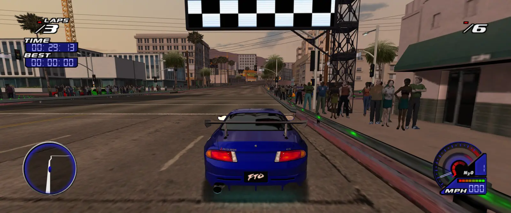
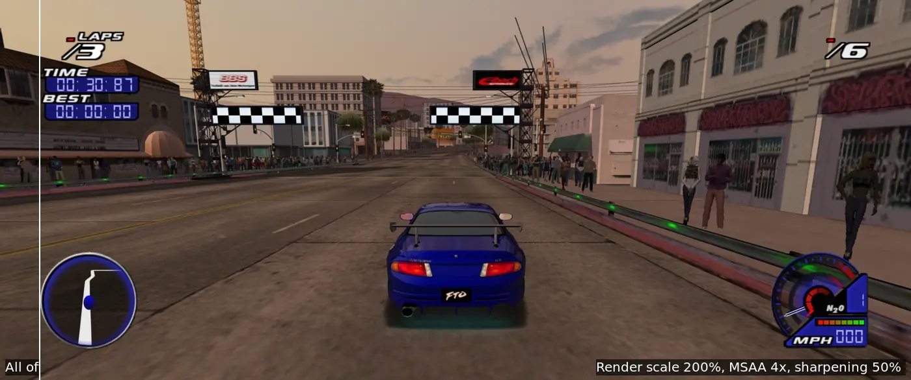
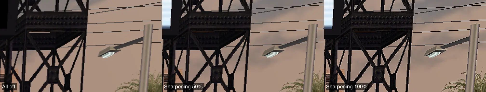

# Juiced - XBE Recomp

An unofficial native PC port of the original Xbox version of Juiced. The game's own x86 code is statically
recompiled with the [Xbox XBE Recomp](https://github.com/TGP482/XboxXBE-Recomp) tool. It is not an emulator.

> [!NOTE]
> This project does not include any game assets. You must provide the files from your own legally acquired copy of
> the game to build and play.

## Status

In progress. Races and the menus play on Windows, with widescreen, high frame rates and the PC settings
below. Smooth motion above 60 can still make some lights and the neon under the cars flicker; turn it off in F1 if
you see that.

## Supported version

The USA/Europe Xbox release (one disc for both), title id 545100EF. `default.xbe` SHA-1
`b38b935794b05e46b70b164acdcca9338f0b692f`.

## Getting started

A launcher, as the other ports have, will come with the first release. Until then, build the game by hand: see
[Building](#building).

**You need:** Windows 10 or 11, 64 bit, a GPU with Direct3D 12, and your own copy of the game (an `.iso` image of
your disc, or a folder with its files).

**Minimum spec:** any 64 bit processor from the last ten years and a Direct3D 12 graphics card run the game at its own
60 frames a second. Frame rates above 60 (Smooth motion) need more: the frames in between are drawn in the time the
game leaves free in each of its 60 steps a second, so they depend on one fast processor core more than on the
graphics card. As a guide from our own machines: a Ryzen 7 5800X3D shows 180 to 240 frames a second at 3440x1440; a
Ryzen 5 5600G (in a virtual machine, with an Intel Arc A750) has no time left for extra frames at 1080p and stays at
60. When there is no room, the game just runs at 60: nothing breaks.

## Screenshots

  
   
  <i>On the start line, 3440x1440, with the HUD kept in its 4:3 centre.</i>

## Features

Set in the F1 window (or `settings.toml` beside the exe); the runtime's own display, graphics and controller options
are there too.

- **Widescreen** - True proportions on any frame wider than 4:3, with the 3D view widened and the menus and HUD kept
  in a 4:3 centre.
- **High frame rates** - The game runs its 60 steps a second as on the console, as its driving needs. Above a frame
  rate cap of 60, races draw the frames in between, made from the two steps before. Turn Vertical Sync off for the
  most frames.
- **Field of view** - 50 to 150% of the game's race camera.
- **Speed blur** - The blur towards the screen's edges at speed, on or off.
- **Engine and effects level** - The disc's race mix is much louder than its menus and clips; this sets the engines
  and effects against the music (50% by default).
- **Skip intro** - Starts without the logo movies, the intro and the warning pages.
- **Modern button pictures** - Prompts and the controls page show today's Xbox pad; on keyboard, your keys.
- **PC Settings** - In the game's own menus: Options > PC SETTINGS on the title menus and the pause menu.
- **Mouse in the menus** - Point at an item and click to select it; right click goes back.
- **Screenshots** - F12 saves the frame as a full resolution PNG in the `screenshots` folder beside the game, without
  the settings window.
- **Sharp 2D** - Text and HUD pictures enlarged with sharp edges.
- **Controllers and wheels** - Xbox, PlayStation and Switch pads with hot plugging and rumble; steering wheels with
  force feedback.

### Keyboard

| Control | Key |
| --- | --- |
| Throttle / brake | W / S |
| Steer | A / D |
| Handbrake | Space |
| Gear up / down (and reverse) | E / Q |
| Nitrous | Left Shift, N |
| Change view | C |
| Glance left / right / back | J / L / K |
| Horn | H |
| Pause | Esc, P |
| Driver info | Tab |
| Menus | Arrows move, Enter selects, Backspace goes back |

Keys can be changed in the F1 window. On a pad, RB changes the view.

## Graphics settings

In PC Settings or the settings window (F1, Graphics). These are shots of one spot at 3440x1440, taken one after
another.

  
   
  <i>All off vs. render scale 200%, MSAA 4x and sharpening 50%.</i>

  
   
  <i>Edges, enlarged twice: all off, MSAA 4x, FXAA and render scale 200%.</i>

- **MSAA** smooths the edges of the 3D scene and keeps textures sharp. The more samples, the slower.

  
   
  <i>MSAA off, 2x, 4x and 8x, enlarged twice.</i>

- **Edge smoothing** works on the finished frame, HUD included: FXAA softens it a little, SMAA keeps it crisper.

  
   
  <i>Edge smoothing off vs. SMAA, enlarged twice.</i>

- **Smooth alpha edges** soften fences, palm leaves and other cut-out textures, with MSAA on.
- **Texture filtering** keeps roads and walls sharp into the distance.
- **Scaling filter** chooses how the frame reaches the screen when render scale is not 100%: bilinear, or sharp.
- **Enhanced textures** double the 3D scene's textures in the background. They use more video memory and can cause a
  brief hitch as new ones appear.
- **Render scale** draws the picture larger than the screen: the smoothest fine detail, and the slowest.

  
   
  <i>Sharpening off, 50% and 100%, enlarged twice.</i>

- **Sharpening** makes the picture crisper. Around 50% is a good start.

## Community and support

Join the [Discord server](https://discord.gg/PQjkKsdtc) for help getting the game running, to report problems, and
to talk about the port with other players.

## Tips and troubleshooting

- **The most frames above 60:** set a Frame Rate Cap above 60 and turn **Vertical Sync off**. The game's own 60 steps
  a second get whole frames between them, so the counter settles on 120, 180 or 240.
- **Flickering lights or neon:** turn **Smooth motion above 60** off in F1. The game then runs at 60.
- **Something wrong:** the first lines of `logs\juiced.log` beside the game list your settings and GPU. Please include
  that file when you report a problem.

## Building

For developers.

1. Clone with submodules: `git clone --recurse-submodules https://github.com/hk21x/juiced-recomp`.
2. Put your disc in `assets`: an `.iso`, or `default.xbe` with the game's folders beside it.
3. Install Visual Studio 2022 with **Desktop development with C++**, **C++ Clang tools for Windows** and **C++ CMake
   tools for Windows** (`build.bat` offers to add the last two), and run `build.bat`. The first build recompiles the
   game and takes a while. The exe is in `out\build\release`.

## Credits

- [Xbox XBE Recomp](https://github.com/TGP482/XboxXBE-Recomp), the recompiler and runtime this is built on.
- [XenonRecomp](https://github.com/hedge-dev/XenonRecomp) for the overridable function layout and instruction hooks.
- [Zydis](https://github.com/zyantific/zydis) for decoding x86 instructions, [toml++](https://github.com/marzer/tomlplusplus)
  for the configs, [Dear ImGui](https://github.com/ocornut/imgui) for the settings overlay and
  [SDL](https://github.com/libsdl-org/SDL) for the window, input and controllers.
